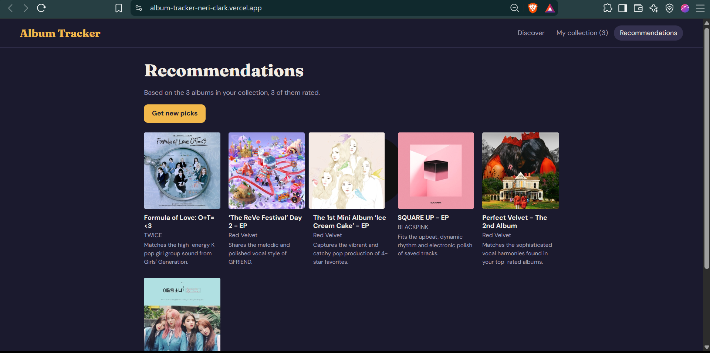

# Album Tracker

Album Tracker is a React web app for tracking your music listening. It lets you look up albums, preview tracks, and log what you hear in a personal database.
You can save albums to your collection to rate them (1–5 stars), update your listening status, and write notes. The UI features a persistent mini-player for quick previews and integrates with Deezer for full-album playback. It also gives you personalized album recommendations based on your listening history.

**[Live Demo]([https://album-tracker-neri-clark.vercel.app/])**


## 📸 Screenshots

*(Replace these image links with your actual screenshots)*




## ✨ Features

* **Discover:** Search for albums and artists using the iTunes Search API.
* **Album Details:** View cover art, release year, genre, track lists, and links to listen on Spotify, YouTube, and Apple Music.
* **Mini Player:** A persistent bar at the bottom of the screen with play/pause, next/previous, and a seek bar for 30-second iTunes previews.
* **My Collection:** Save albums and track your listening journey with statuses (Want to listen, Listening, Listened), star ratings, and personal notes. Filter and sort your collection easily.
* **Deezer Integration:** If Deezer has the album, users can swap the 30-second previews for Deezer's full-album embedded player.
* **AI Recommendations:** Uses Google Gemini to analyze your saved albums and ratings to suggest 6 new albums you might love, complete with a short reason for each pick.

## 🛠️ Tech Stack

* **Frontend:** React, Vite, Context API
* **Data Sources:** iTunes Search API (Music data & previews), Deezer API (Full album embeds)
* **AI:** Google Gemini API
* **Deployment:** Vercel (Serverless Functions for API key protection)


## 🚀 Getting Started

Follow these steps to get the project running on your local machine:

1. **Clone the repository:**
   ```bash
   git clone https://github.com
   cd album-tracker
   ```

2. **Install dependencies:**
   ```bash
   npm install
   ```

3. **Set up environment variables:**
   Create a `.env.local` file in the root directory of the project and add your API keys:
   ```env
   VITE_GEMINI_API_KEY=your_google_gemini_api_key_here
   ```

4. **Run the development server:**
   ```bash
   npm run dev
   ```
   Open [http://localhost:5173](http://localhost:5173) in your browser to view the app.

## ⚠️ Limitations

* **30-Second Previews:** Default audio previews fetched from the iTunes Search API are limited to 30-second snippets.
* **Local Storage:** Your music collection, ratings, and notes are saved directly in your browser's local storage. Clearing your browser data will reset your collection.
* **Deezer Authentication:** To listen to full tracks instead of snippets through the Deezer widget, you must be logged into an active Deezer account in your browser.

## 🔒 Privacy & Disclaimer

* **AI Privacy Note:** The personalized recommendation feature sends a list of your saved album titles, artists, and star ratings to the Google Gemini API to generate suggestions. No personal identifiers or sensitive user data are collected or transmitted.
* **Disclaimer:** This project is directly just for a Laboratory Activity for my subject. It is not affiliated with, authorized, maintained, sponsored, or endorsed by Apple, Spotify, Deezer, or Google.